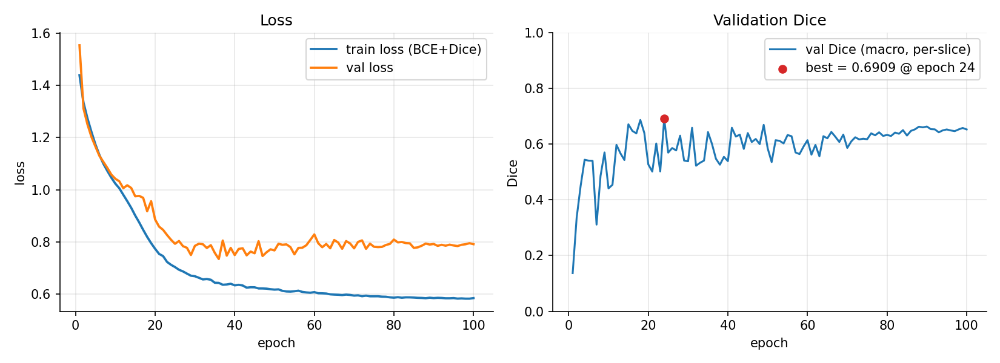
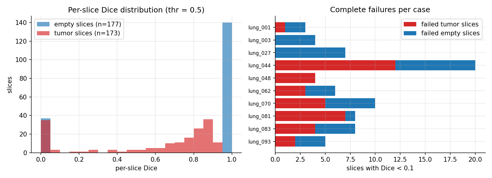
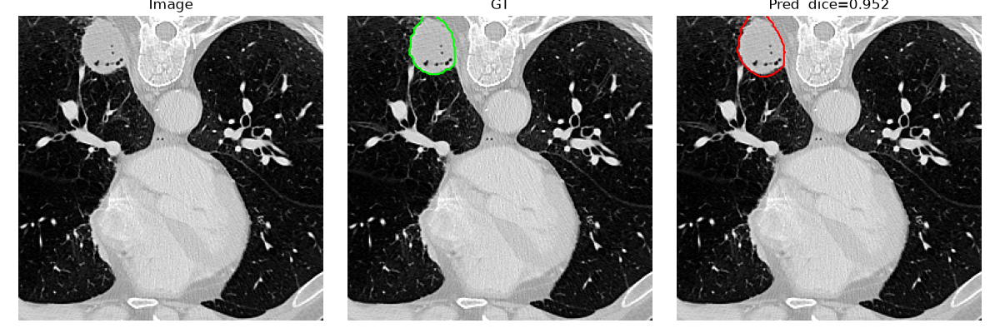
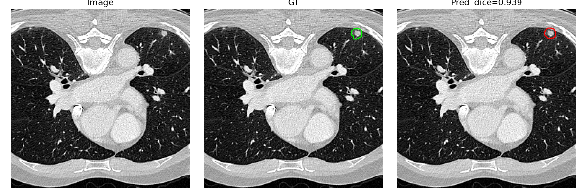
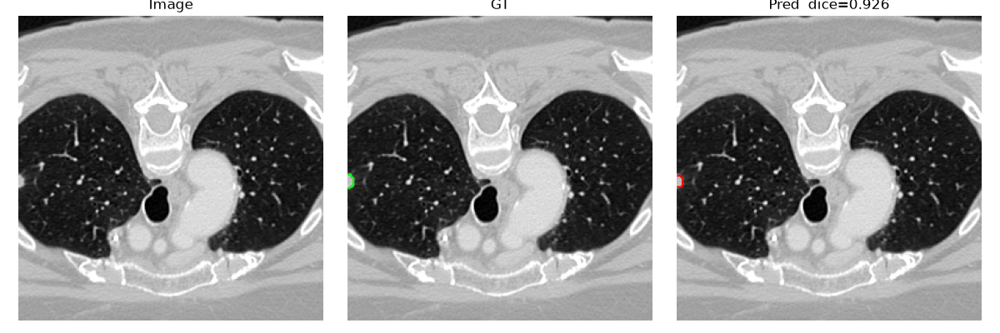
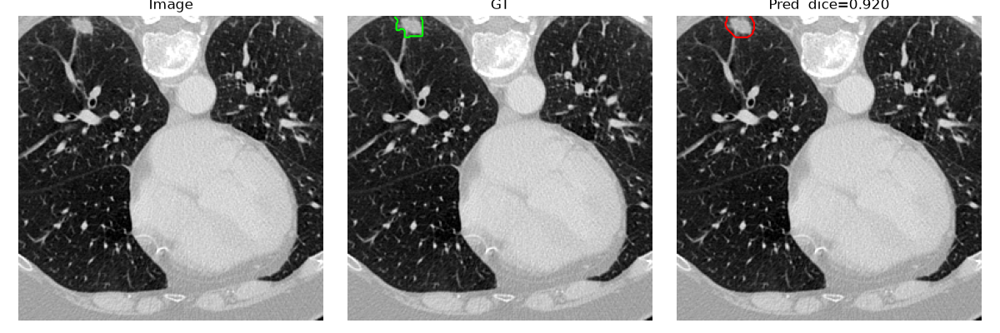

# 2D U-Net for Lung Tumor Segmentation on CT Slices

[](https://www.python.org/)
[](https://pytorch.org/)
[](LICENSE)
[](https://medicaldecathlon.com/)

A compact, fully reproducible 2D U-Net pipeline for **per-slice lung tumor segmentation**
on the [Medical Segmentation Decathlon Task06 (Lung)](https://medicaldecathlon.com/) dataset.
The repository ships an offline slice-preprocessing stage that makes training **~12× faster**,
a per-slice evaluation protocol that matches training-time metrics exactly, and an honest
failure analysis of where a small 2D baseline breaks down.

## Results

**Validation set: 10 held-out cases (350 axial slices, 1:1 tumor/empty), metric = per-slice Dice (macro), threshold 0.5.**
The 10 held-out cases are used both for model selection and reporting (MSD provides no public test labels).

| Metric | Value |
|---|---|
| Mean Dice (all 350 slices) | **0.691** |
| Mean Dice (tumor slices, n = 173) | 0.589 |
| Mean Dice (empty slices, n = 177) | 0.791 |
| Median Dice | 0.859 |

**Decision-threshold ablation** (same checkpoint):

| thr | mean | tumor | empty |
|---|---|---|---|
| 0.5 | 0.6910 | 0.5888 | 0.7910 |
| 0.6 | 0.6926 | 0.5862 | 0.7966 |
| 0.7 | 0.6965 | 0.5826 | 0.8079 |

Threshold barely moves the needle — the remaining errors are **high-confidence**, not borderline.

**Training configuration:** U-Net (7.2M params), BCE+Dice loss, AdamW 1e-4, cosine schedule,
100 epochs, mixed precision, single RTX 4060 Laptop 8 GB.



## Per-slice analysis

The Dice distribution is **bimodal**: 79% of empty slices are perfectly clean, but ~21% are
confident false positives; 65% of tumor slices land in the 0.5–0.9 band while 22% are complete
misses. Failures spread across **all 10 validation cases** — a systematic limitation of a small
baseline (weak augmentation, 7.2M params), not one bad case.



### Sample predictions (image / ground truth / prediction)

<p align="center">
  
  
  
  
</p>

## What the engineering iterations changed

| Iteration | Change | Effect |
|---|---|---|
| on-the-fly reading | decode the full 3D volume per slice | 637 s/epoch — GPU starved at 2 GB |
| **offline slicing** | pre-extract slices to `.npz` | **54 s/epoch (~12×)**, GPU-bound |
| center-crop 512→256 | 27% of tumor slices (47/175) lost their tumor outside the crop | inflated metrics, missed peripheral tumors |
| **full-view resize 512→256** | tumors never cropped away | 173/175 tumor slices retained (98.9%) |
| batch-pooled val Dice | failures penalized by pixel area | best-model selection driven by noise |
| **per-slice (macro) val Dice** | identical to evaluation protocol | training log = evaluation number (0.6909 vs 0.6910) |

## Dataset

[Medical Segmentation Decathlon — Task06 Lung](https://medicaldecathlon.com/):
**63 training CT volumes** (as released; source: The Cancer Imaging Archive), 512×512 axial CT,
binary lung-tumor masks. This repository does **not** redistribute the dataset — download it from
the official site and place it under `data/msd_task06/Task06_Lung/` (see below).

Preprocessing: lung-window HU clip [-1000, 400] → [0, 1]; full-view resize 512→256
(bilinear image / nearest mask); per-case train/val split (last 10 cases held out);
slices = all tumor slices + an equal number of random empty slices → 2,964 train / 350 val.

## Getting started

```bash
pip install -r requirements.txt

# 1) one-time preprocessing (~minutes)
python prepare_slices.py --data_root data/msd_task06/Task06_Lung --out data/slices --size 256 --resize

# 2) train — reproduces the reported results (base 32, light augmentation)
python train.py --prepared data/slices --batch_size 16 --lr 1e-4 --epochs 100

#    optional (in progress, not yet reported): stronger augmentation + bigger backbone
#    python train.py --prepared data/slices --base 64 --batch_size 8 --lr 1e-4 --epochs 100 --strong_aug --ckpt_dir data/ckpt_v5

# 3) evaluate + triptych visualizations + per-slice CSV
python infer_eval.py --prepared data/slices --ckpt data/checkpoints/best.pth --out data/preds

# regenerate README figures from your own logs
python make_figures.py --log data/checkpoints/train_log.txt --csv data/preds/dice_per_slice.csv
```

No data yet? Smoke-test the whole pipeline in ~1 minute on synthetic data:

```bash
python make_dummy_data.py --out data/smoke --cases 14
python check_msd.py --root data/smoke
python prepare_slices.py --data_root data/smoke --out data/slices_smoke --size 64 --resize
python train.py --prepared data/slices_smoke --epochs 3 --batch_size 4
```

## Repository layout

```
├── check_msd.py          # dataset sanity check (modality/shape/HU/tumor volume)
├── msd_2d_dataset.py     # on-the-fly + prepared-slice datasets (augmentation lives here)
├── prepare_slices.py     # offline 3D→2D preprocessing (~12× training speedup)
├── unet.py               # standard U-Net (bilinear / transposed-conv upsampling)
├── train.py              # BCE+Dice, AMP, cosine LR, per-slice val Dice, best+last ckpt
├── infer_eval.py         # per-slice inference, triptych plots, per-slice CSV
├── make_figures.py       # README figures from train_log / dice CSV
├── make_dummy_data.py    # synthetic MSD-style data for a 1-minute smoke test
├── verify_extra.py       # determinism / leakage / tensor-contract checks
├── docs/figures/         # training curves, Dice distribution
└── docs/samples/         # sample prediction triptychs
```

## Known limitations

- The 10 held-out cases serve as both validation and test — numbers above are validation numbers.
- 2D slicing ignores cross-slice 3D context; per-slice Dice here is **not** directly comparable
  to per-case 3D Dice in the literature (for reference, a public nnU-Net baseline reports
  [0.716 per-case 3D Dice](https://huggingface.co/Lab-Rasool/CLN-Segmenter-MSD-fold0) on this task
  with a far heavier pipeline).
- ~21% false-positive slices and 22% missed tumor slices remain — stronger augmentation and a
  larger backbone are the next levers being explored.

## License

- **Code:** MIT (see [LICENSE](LICENSE)).
- **Dataset:** Medical Segmentation Decathlon data is released under **CC-BY-SA 4.0**
  (per the [official website](https://medicaldecathlon.com/)). The sample figures in
  `docs/` are derived from it and are shared under the same terms.

## Citation

If you use the dataset, please cite:

```bibtex
@article{antonelli2022msd,
  title   = {The Medical Segmentation Decathlon},
  author  = {Antonelli, Michela and others},
  journal = {Nature Communications},
  volume  = {13},
  pages   = {4128},
  year    = {2022}
}
@article{simpson2019msd,
  title   = {A large annotated medical image dataset for the development and evaluation
             of segmentation algorithms},
  author  = {Simpson, Amber L. and others},
  journal = {arXiv preprint arXiv:1902.09063},
  year    = {2019}
}
```
